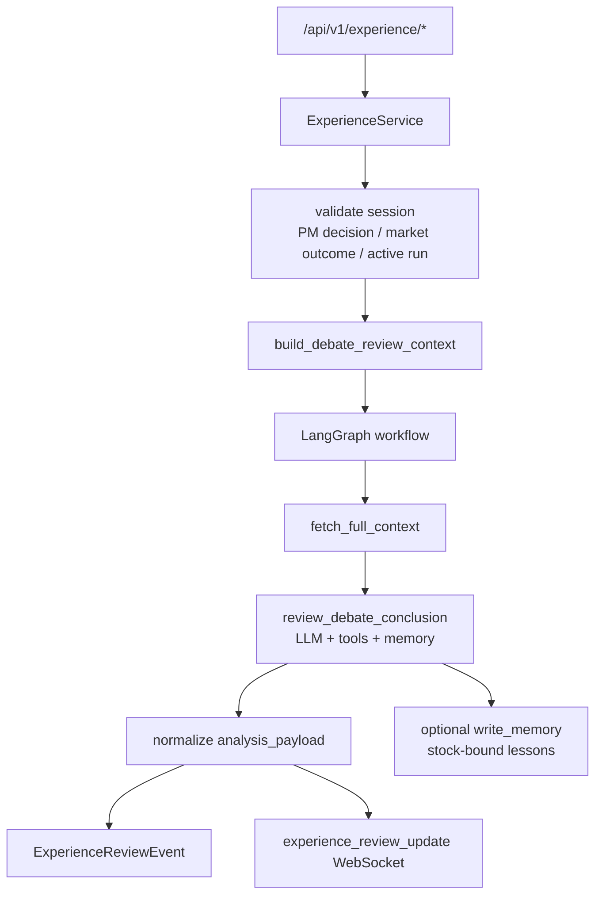
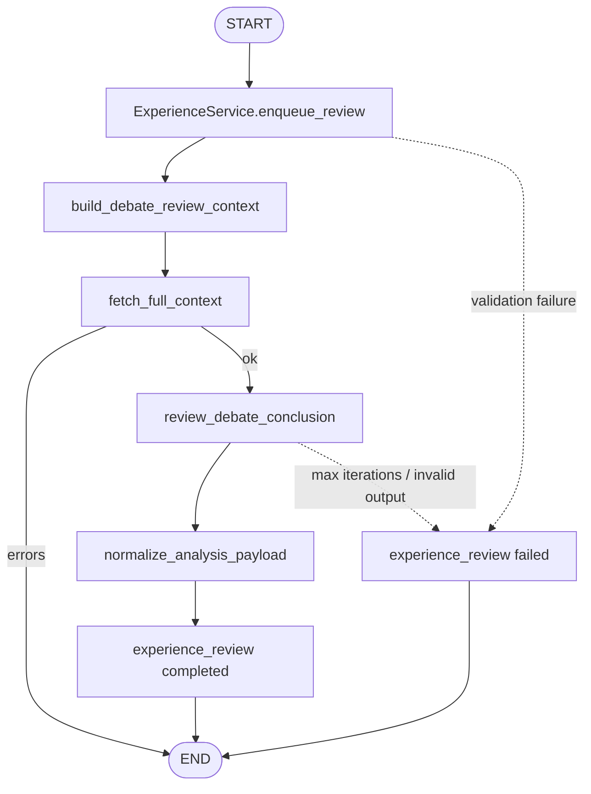

# Experience Review System 设计文档

`experience` 是单股 AI 辩论后的后验复盘系统。它不重新选股，也不重新跑普通单股分析；它把已经产生 PM 决策的 debate session 与决策后的真实市场表现放在一起，判断原始结论是否正确，解释涨跌主因，并在提炼出可复用经验时写回长期记忆。

本文按“先总后分”组织：先说明模块定位、总体架构和复盘数据流，再展开发起条件、工作流、市场结果口径、LLM 复盘、记忆写入和前端契约。

## 1. 总体设计

### 1.1 设计目标

- 后验检验：用 PM 决策后的价格路径、回撤和相对收益验证原始结论。
- 主因归因：区分真正驱动涨跌的因素、被证伪信号和噪音信号。
- 流程改进：识别 debate 流程中的遗漏、误判、仓位纪律和卖出设计问题。
- 经验沉淀：把可复用交易规则、失败教训和流程改进写入长期记忆。
- 可追踪：每个 review run 的事件、工具调用和最终结果都可查询。
- 用户隔离：复盘只能访问当前用户自己的 session 和股票绑定记忆。

### 1.2 总体架构

### 1.3 核心文件

| 文件 | 职责 |
| --- | --- |
| [`api.py`](./api.py) | `/api/v1/experience/*` 接口入口。 |
| [`service.py`](./service.py) | 发起校验、复盘上下文构建、事件持久化、结果查询、删除和中断恢复。 |
| [`workflow.py`](./workflow.py) | LangGraph 复盘工作流、LLM 工具循环、结构化输出和记忆写入约束。 |
| [`schemas.py`](./schemas.py) | 请求、复盘结果、事件和 run 列表响应结构。 |
| [`experience_review_event.py`](../../models/experience_review_event.py) | 复盘事件表模型。 |
| [`experience_review_scheduler.py`](../../tasks/experience_review_scheduler.py) | 盘后自动扫描可复盘 session，并把到期复盘加入全局队列。 |

## 2. 端到端流程

### 2.1 API 入口

API 挂载在 `/api/v1/experience`：

- `POST /analyze`：校验并入队，返回 `202` + `review_run_id` + 队列位置。
- `GET /debate-sessions`
- `GET /review-events/{session_id}`
- `GET /review-runs`
- `GET /review-run-events/{review_run_id}`
- `GET /review-run-result/{review_run_id}`
- `DELETE /review-runs/{review_run_id}`
- `DELETE /review-runs`

前端入口是 `/experience` 页面。运行中事件通过 `experience_review_update` WebSocket 推送。

后台入口是 `ExperienceReviewScheduler`。自动复盘默认关闭，可在系统设置页开启并配置执行时间、单次最大任务数
和候选扫描数量。默认执行时间为每天 18:30（Asia/Shanghai）。调度器只负责入队，实际执行由全局 worker 池按
`EXPERIENCE_REVIEW_MAX_CONCURRENT`（默认 3）并发消费。

### 2.2 发起条件

发起复盘只需要传：

- `session_id`

后端校验：

1. session 属于当前用户。
2. session 已有 `DebateMessage`。
3. session 已有最新 PM 决策。
4. 同一 session 没有运行中的复盘 run。
5. PM 决策后能构造市场结果摘要。
6. 运行中的旧 run 超过 `STALE_REVIEW_TIMEOUT = 2h` 会先标记失败。

自动调度额外要求：

1. session 状态为 `completed`。
2. PM 决策日开始至少有 6 条日 K，满足 5D 自动复盘的最小数据要求。
3. 自动调度按 `5d`、`20d`、`60d` 分别判断是否达到数据要求，并跳过已有事件占用的周期。
4. 单次扫描最多发起配置允许的 run 数，默认 2 个，避免盘后集中消耗 LLM 资源。

### 2.3 工作流拓扑

LangGraph 内部只有两个节点：

- `fetch_full_context`
- `review_debate_conclusion`

复杂度主要在 service 侧的上下文构建和 workflow 侧的 LLM 工具循环。

## 3. 核心数据设计

### 3.1 `debate_review_context`

`service.py` 从数据库构造复盘上下文：

| 字段 | 含义 |
| --- | --- |
| `session` | 原始 debate session 信息。 |
| `pm_decision` | 最新 PM 决策、置信度、仓位、止损、价格区间和执行计划。 |
| `debate_timeline` | 各 Agent 报告按时间排序后的结论文本。 |
| `agent_position_summary` | 各角色最近几次 decision 摘要。 |
| `orders` | 数据库原始订单记录，不包含聚合指标。 |
| `trades` | 数据库原始成交记录，不包含聚合指标。 |
| `market_outcome_summary` | 数据库原始日 K 和沪深300日 K 窗口，不包含任何计算指标。 |

`market_outcome_summary` 只提供原始数据和范围元数据：

- `data_range`：`review`、`latest`、`holding`、`benchmark` 四个窗口的起止日期和交易日数。
- `time_range`：本次返回的全部数据的总起止日期。
- `review_window`：决策日到所选复盘日的原始日 K；5D 含 6 根、20D 含 21 根、60D 含 61 根。
- `latest_window`：最新最多 30 根原始日 K，只用于后续验证，不用于重算所选周期。
- `holding_window`：存在 `holding_horizon_days` 时，从决策日到持有期到期后第一个交易日的原始日 K，并给出 `reached`。
- `benchmark_window`：沪深300（`000300.SH`）原始日 K，只包含上述窗口出现过的相同交易日。

系统不提供收益、回撤、相对收益、入场价、持有期结果或成交聚合值。复盘提示词要求模型基于原始行自行计算：需要数据库数据时优先使用 `query_and_calculate`，先 `get_database_schema` 确认字段并传 `columns`/`limit`；禁止把 `review_input` 或数据库数值手工抄进 `execute_python_sandboxed`，后者只用于对工具返回结果做二次纯算术。入场价规则：有买入成交时用 `trades` 成交价，没有成交时用决策日次日开盘价。`debate_correctness` 仍以所选周期和 PM 持有期为主，最新窗口只用于补充后续验证、解释涨跌和提炼教训。若数据缺失或明显落后，提示词要求模型先用 `get_current_time` 判断，再按需通过 `sync_market_data` 同步并用 `query_stock_data` 核对。

### 3.2 工作流状态

`ExperienceWorkflowState` 在 LangGraph 节点间传递：

- `user_id`
- `session_id`
- `review_run_id`
- `stock_code`
- `stock_name`
- `industry`
- `style_bucket`
- `trading_frequency`
- `trading_strategy`
- `debate_review_context`
- `full_context`
- `analysis_payload`
- `tool_trace`
- `review_events`
- `event_callback`
- `errors`

### 3.3 事件表

`ExperienceReviewEvent` 是复盘 run 的唯一持久化主线：

- `event_id`
- `review_run_id`
- `session_id`
- `user_id`
- `event_type`
- `stage`
- `status`
- `message_key`
- `message_params`
- `payload`
- `created_at`

run 列表和 run 结果都从同一个事件表聚合。删除 review run 本质上是删除该 run 的事件。

## 4. 分模块设计

### 4.1 Service

`ExperienceService` 负责非 LLM 逻辑：

- 校验发起条件。
- 将手动/API/调度触发统一写入 `experience_review_runs` 队列。
- 防止同一 session 以及同一用户同一股票并发排队/运行。
- 清理重启中断或超时 stale run；保留 queued 任务继续消费。
- 构造 `debate_review_context`。
- 持久化 queued / started / completed / failed / tool_call 事件。
- 推送 WebSocket 更新。
- 归一化 `analysis_payload`。
- 查询 run、event、result。
- 删除 run。

Service 不负责 prompt 编写和工具调用循环，这些在 `workflow.py` 中。

### 4.1.1 Queue 与全局并发

- `POST /analyze` 只做校验和入队，返回 `202` 与 `review_run_id`，不阻塞等待复盘完成。
- `experience_review_runs.status` 使用 `queued/running/completed/failed`。
- `EXPERIENCE_REVIEW_MAX_CONCURRENT` 控制进程内 worker 数量，当前默认 `3`。当前部署按单 backend 实例保证全局 N；多实例部署时每个进程各有 N 个 worker，需要额外的 DB slot/Redis 分布式信号量才能严格全局 N。
- worker 使用 `FOR UPDATE SKIP LOCKED` 按 `created_at` FIFO 领取 queued 任务；超过并发上限的任务只保留在队列中。
- 同一 `session_id` 以及同一 `user_id + stock_code` 在 queued/running 期间由 partial unique index 保证唯一。
- 调度器只负责入队，`max_runs_per_tick` 限制每轮入队候选数；同股票已有 queued/running 任务时跳过，留到下一次调度。
- 启动时 queued 任务继续执行；中断的 running 任务标记 failed。

### 4.2 Market Outcome

市场结果只提供数据库原始数据，不提供计算指标：

- `data_range` / `time_range`：数据窗口和总覆盖范围。
- `review_window`：决策日到所选复盘日的原始日 K，5D/20D/60D 分别为 6/21/61 根。
- `latest_window`：最新最多 30 根原始日 K，只用于后续验证。
- `holding_window`：PM 持有期到期后的原始路径。
- `benchmark_window`：沪深 300 在相同交易日的原始日 K。

收益、回撤、相对收益和持有期结果由复盘 LLM 基于原始行自行计算。工具拿到的当前信息只能补充解释，不能覆盖输入里的历史原始事实。

### 4.3 Workflow

`workflow.py` 定义两个节点。

`fetch_full_context`：

- 提取 session、PM 决策、辩论 timeline、执行摘要和市场结果。
- 推送 `fetch_context completed` 事件。
- 失败时写入 `errors`，后续节点不执行。

`review_debate_conclusion`：

- 构造复盘 prompt。
- 绑定普通工具、记忆工具和 Skills loader 工具。
- 循环调用 LLM 和工具。
- 记录工具调用 trace。
- 要求最终输出符合 `ExperienceReviewOutput`。
- 只有提炼出可复用赚钱经验、失败教训、仓位纪律或流程改进规则时才调用 `write_memory`；没有新增可复用经验时可以跳过记忆写入。
- 结构化输出失败后做 JSON-only retry。

### 4.4 LLM 复盘约束

复盘 LLM 必须围绕后验市场结果工作：

- 判断原始 PM 结论是否正确。
- 找出决策后涨跌的主要原因，并区分被验证、被证伪和噪音信号。
- 将可复用的驱动判断、买卖规则和 debate 流程改进写入记忆文档，而不是重复塞进最终 JSON。
- 不能把工具返回的当前信息当作决策时点历史事实。

执行参数：

- `EXPERIENCE_REVIEW_MAX_ITERATIONS = 50`
- `EXPERIENCE_REVIEW_FINAL_RETRY_LIMIT = 3`

### 4.5 Memory

复盘阶段使用 `build_memory_tools(...)` 挂载记忆工具，状态中注入：

- `agent_role = AGENT_NAME_PORTFOLIO_MANAGER`
- `user_id`
- `stock_code`
- `session_id`
- `trading_strategy`
- `trading_frequency`

记忆写入约束：

- `write_memory` 不是强制前置步骤；LLM 需要先判断本次复盘是否产生新增可复用经验，没有新增经验时可以直接返回最终 JSON。
- 只支持当前股票绑定记忆。
- 不允许手动传入其他 `stock_code`。
- 如发生写入，内容必须覆盖对象、实际结果、主导驱动、被验证信号、被证伪信号、可复用规则和失效边界。
- 不写普通背景信息或流水账。

## 5. 输出契约

最终 `analysis_payload` 来自 `ExperienceReviewOutput`，并经过 service 归一化。

最终分析结果只保留面向展示的最小字段：

- `original_pm_decision`：原始 PM 动作或结论。
- `debate_correctness`：`correct / partially_correct / incorrect / inconclusive`。
- `correctness_reasoning`：2-4 句后验解释，覆盖所选周期、PM 持有期和最新交易日结果，并包含主要涨跌原因和一条可复用教训；`debate_correctness` 以所选周期和 PM 持有期为主。
- `written_memories`：记忆文档写入元数据，不包含文档正文，包含状态、版本、大小、上限和失败原因。

工具调用轨迹不放入 `analysis_payload`，由顶层 `tool_trace` 单独保留，供审计和按需展开查看。

重要口径：

- 完整 Markdown 只通过记忆文档查看器读取，不在经验分析结果中重复展示。
- 经验规则、驱动证据和流程改进只沉淀在记忆文档中。
- `debate_correctness` 只能是 `correct / partially_correct / incorrect / inconclusive`。

## 6. 可观测性

运行中会写入并推送：

- `experience_review started`
- `fetch_context completed`
- `tool_call running`
- `experience_review completed`
- `experience_review failed`

关键 payload：

- `review_run_id`
- `stock_code`
- `stock_name`
- `tool_trace`
- `recommended_action`
- `debate_correctness`
- `result`
- `error`

应用启动时会调用 `cleanup_interrupted_review_runs()`，把仍处于 `started / running` 的旧 run 标记为 failed，保留 `queued` run 由 worker 继续消费。查询列表时也会清理超过 2 小时的 stale run。

## 7. 前端契约

前端消费：

- `GET /debate-sessions`：可复盘 session 列表，只返回有 PM 决策的 session。
- `GET /review-events/{session_id}`：某个 debate session 最新复盘事件。
- `GET /review-runs`：当前用户所有复盘 run。
- `GET /review-run-events/{review_run_id}`：指定 run 的事件流。
- `GET /review-run-result/{review_run_id}`：指定 run 的最终结果。

前端应以 `review_run_id` 区分不同复盘 run，以 `stage/status/message_key/message_params` 渲染时间线。

## 8. 扩展规则

### 8.1 修改市场结果口径

需要同步：

1. `_build_market_outcome_summary()`。
2. 复盘 prompt 中的事实口径说明。
3. `ExperienceReviewOutput` 中相关字段。
4. 前端结果页展示。
5. 测试用例。

### 8.2 新增输出字段

需要同步：

1. `ExperienceReviewOutput`。
2. `_normalize_analysis_payload()`。
3. `ExperienceAnalyzeResponse` 或结果页 schema。
4. completed event payload。
5. 前端消费逻辑。

### 8.3 修改记忆策略

必须保持：

- 不绕过 `write_memory` 要求。
- 不写通用记忆，除非后端记忆工具和产品逻辑明确支持。
- 记忆不能覆盖市场结果事实。
- 写入内容必须是高信息密度经验，而不是复盘流水账。

## 9. 当前边界

- 只能复盘已有 PM 结论的 debate session。
- 必须有决策后的 K 线样本，否则拒绝复盘。
- 不重新跑选股、普通单股分析或 PM 决策。
- 复盘结果用于改进系统和模拟研究，不构成投资建议。
- Memory 可用性取决于后端 Memory 配置和服务健康状态。

## 10. 推荐阅读顺序

1. [`service.py`](./service.py)
2. [`workflow.py`](./workflow.py)
3. [`schemas.py`](./schemas.py)
4. [`api.py`](./api.py)
5. [`experience_review_event.py`](../../models/experience_review_event.py)
